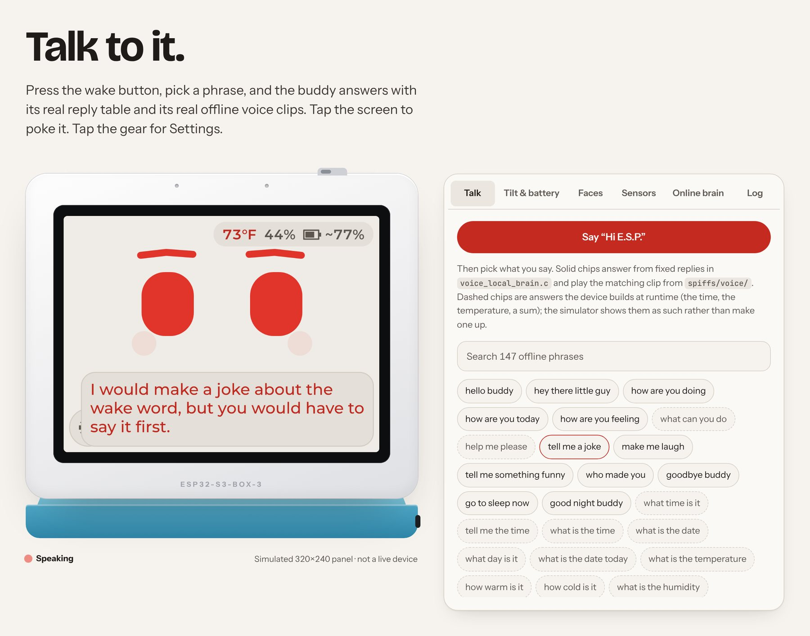
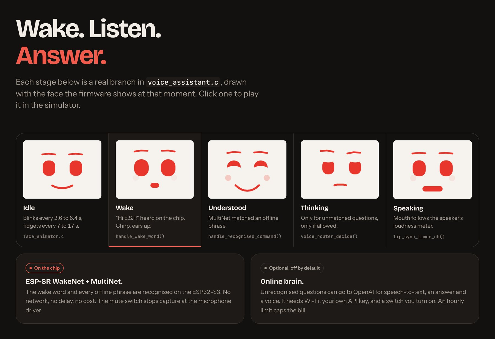
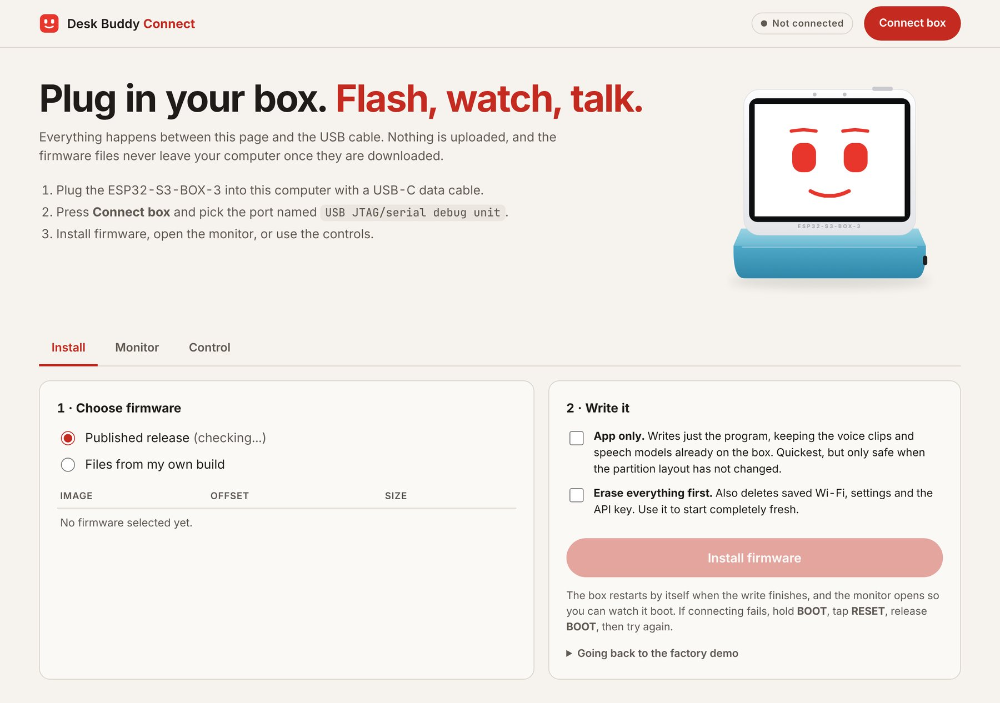
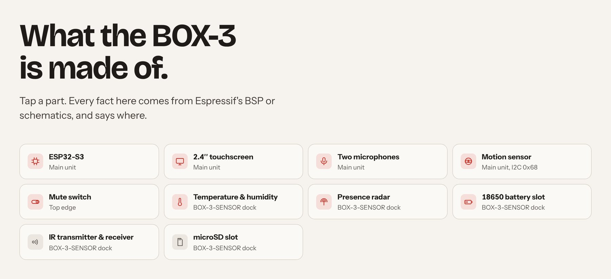
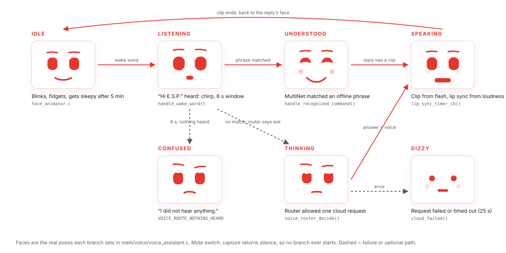
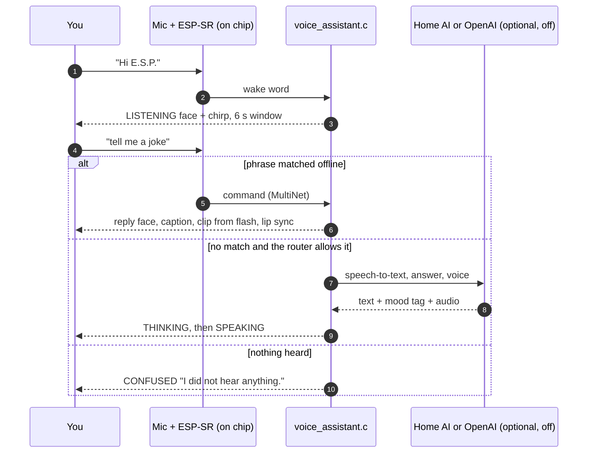
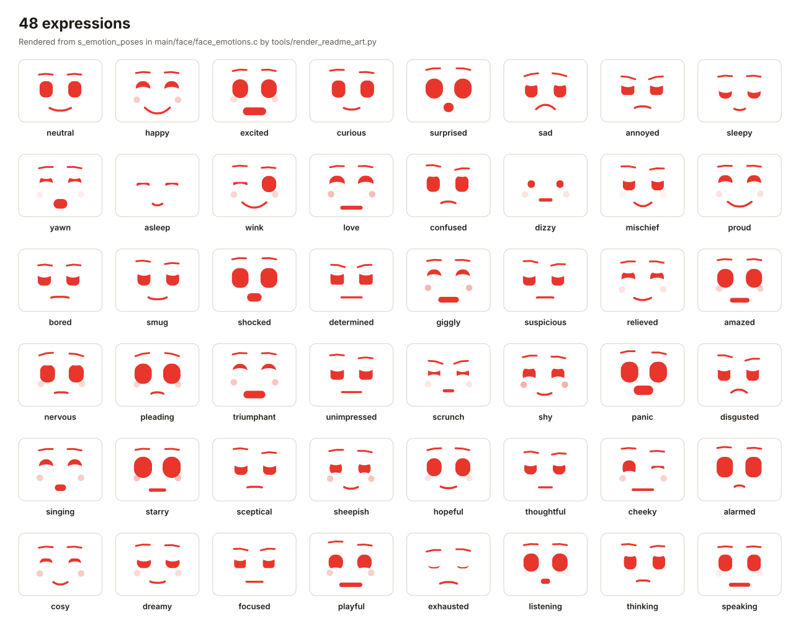
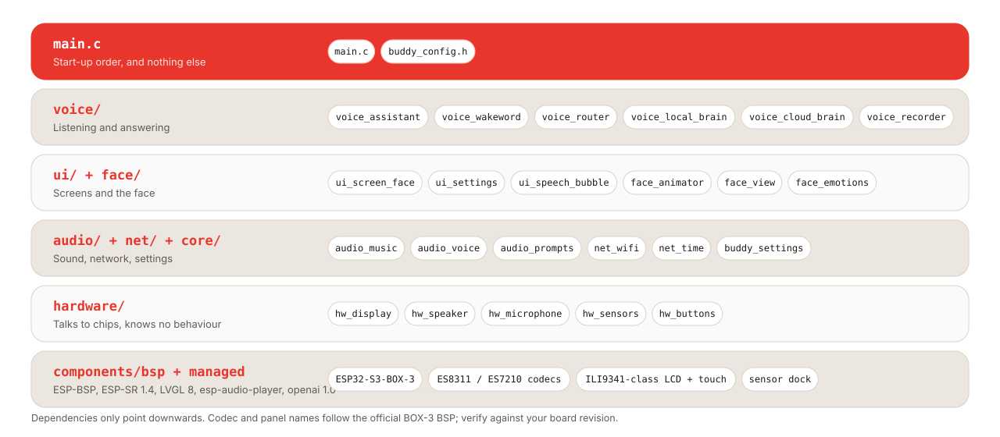

<p align="center">
  
</p>

<h3 align="center">An offline-first voice assistant with a face, for the ESP32-S3-BOX-3.</h3>

<p align="center">
  <a href="https://github.com/Normansrule/esp-box-voice-assistant/actions/workflows/ci.yml"></a>
  <a href="https://normansrule.github.io/esp-box-voice-assistant/"></a>
  
  
  
  
  <a href="LICENSE"></a>
</p>

<p align="center">
  <a href="https://normansrule.github.io/esp-box-voice-assistant/"><b>Live simulator</b></a> ·
  <a href="#quickstart">Quickstart</a> ·
  <a href="#features-and-status">Status</a> ·
  <a href="#how-it-listens">How it listens</a> ·
  <a href="#build-and-flash">Build</a> ·
  <a href="docs/FIRMWARE_GUIDE.md">Firmware guide</a> ·
  <a href="#references-and-acknowledgements">References</a>
</p>

---

**ESP-BOX Voice** is the Desk Buddy firmware for Espressif's **ESP32-S3-BOX-3**. A face on the 320×240 touchscreen hears **“Hi E.S.P.”** on the chip, understands **147 English phrases with no internet**, answers from **393 recorded voice clips** stored in flash, and reacts with **48 expressions**. A small AI on your own PC, or an online model, can answer free-form questions, but both are **off by default**.

On the device, "AI" means speech recognition: ESP-SR WakeNet spots the wake word and MultiNet matches one of the fixed phrases, and each phrase has hand-written replies. Nothing on the chip generates text or speech.

<table>
  <tr>
    <td align="center" width="25%"><b>Offline first</b><br><sub>Wake word and 147 phrases run on the ESP32-S3. No account, no network, no cost.</sub></td>
    <td align="center" width="25%"><b>A face, not a bitmap</b><br><sub>48 expressions drawn from 21 numbers each, blended in real time with lip sync.</sub></td>
    <td align="center" width="25%"><b>Private by design</b><br><sub>The mute switch stops capture at the driver. Online answers stay off until you turn them on.</sub></td>
    <td align="center" width="25%"><b>Honest about status</b><br><sub>Every feature carries a label backed by a build log, a test or a device log.</sub></td>
  </tr>
</table>

> [!NOTE]
> Every image on this page is drawn from the firmware's own tables or captured from the [web simulator](https://normansrule.github.io/esp-box-voice-assistant/). They are **simulations of the UI**, not photos of a device, and none of them shows a real sensor reading.

## Screenshots

<table>
  <tr>
    <td width="50%"><a href="https://normansrule.github.io/esp-box-voice-assistant/#simulator"></a></td>
    <td width="50%"><a href="https://normansrule.github.io/esp-box-voice-assistant/#listen"></a></td>
  </tr>
  <tr>
    <td align="center"><sub><b>Talk to it.</b> The simulator runs the firmware's real reply table and voice clips.</sub></td>
    <td align="center"><sub><b>Wake. Listen. Answer.</b> Each stage maps to a branch in <code>voice_assistant.c</code>.</sub></td>
  </tr>
  <tr>
    <td width="50%"><a href="https://normansrule.github.io/esp-box-voice-assistant/connect/"></a></td>
    <td width="50%"><a href="https://normansrule.github.io/esp-box-voice-assistant/#inside"></a></td>
  </tr>
  <tr>
    <td align="center"><sub><b>Desk Buddy Connect.</b> Flash, monitor and control the box from Chrome or Edge.</sub></td>
    <td align="center"><sub><b>Inside the BOX-3.</b> Every part links to Espressif's BSP or schematic.</sub></td>
  </tr>
</table>

<sub>Regenerate these with <code>node tools/capture_readme_screens.js</code> (see the header of that file).</sub>

## Quickstart

| | Path | What you need |
| --- | --- | --- |
| **1** | **Try it now.** Open the [simulator](https://normansrule.github.io/esp-box-voice-assistant/), press *Say “Hi E.S.P.”* and pick a phrase. | A browser |
| **2** | **Install from the browser.** Plug the BOX-3 in over USB-C, open [Desk Buddy Connect](https://normansrule.github.io/esp-box-voice-assistant/connect/), press *Connect box*. Until a release is published, choose *Files from my own build*. | Chrome or Edge, a BOX-3 |
| **3** | **Build from source.** Four commands, below. | ESP-IDF v5.5.x, a BOX-3 |

```bash
git clone https://github.com/Normansrule/esp-box-voice-assistant && cd esp-box-voice-assistant
idf.py set-target esp32s3
idf.py build
idf.py -p "$ESP_PORT" flash monitor     # then say "Hi E.S.P."
```

Finding `ESP_PORT`, Windows steps and recovery are in [Build and flash](#build-and-flash).

## Features and status

Labels follow [docs/ROADMAP.md](docs/ROADMAP.md). A feature moves to **VERIFIED ON DEVICE** only when its serial log or measurement is committed under `docs/test-logs/`. Nothing in this repository is there yet.

| Feature | Status | Evidence |
| --- | --- | --- |
| Firmware build, esp32s3, ESP-IDF v5.5.5 |  | CI on every push; [docs/BUILD_RESULTS.md](docs/BUILD_RESULTS.md) |
| Host unit tests, source checks |  | `scripts/run_tests.py` in [ci.yml](.github/workflows/ci.yml) |
| Face: 48 expressions, 12 idle antics, blink, lip sync |  | `main/face/` |
| Wake word and 147 offline phrases (ESP-SR WakeNet + MultiNet) |  | `main/voice/` |
| 393 offline voice clips |  | `spiffs/voice/` |
| Mute switch stops capture; muted face and caption on screen |  | `hw_microphone.c` |
| Temperature, humidity, presence (BOX-3-SENSOR dock) |  | `hw_sensors.c` |
| Battery voltage on the dock (GPIO10, ÷4.01), **estimated** percent, low warning |  | `hw_battery.c`; divider from Espressif's SENSOR-01 V1.1 schematic. [Test it](docs/HARDWARE_TESTS.md) |
| Motion (ICM-42607-P): eyes follow tilt, shake → dizzy, pick up → surprised |  | `hw_imu.c`, `buddy_motion.c`. [Test it](docs/HARDWARE_TESTS.md) |
| Screen themes: Paper (day) and Ember (night) |  | `face_theme.c`; [docs/DESIGN.md](docs/DESIGN.md) |
| Home AI: a small AI on your own PC, free, no account |   | [`tools/home_brain/`](tools/home_brain/README.md): maths, dates and units computed exactly by tools; other questions go to llama3.2. Plain `http://` on the LAN. |
| Online brain (OpenAI), off by default |  | `voice_cloud_brain.c`, `voice_router.c` |
| Web simulator |  | Browser only, never device data |
| Consent screen before audio leaves the device, sleep profiles, developer screen |  | [docs/ROADMAP.md](docs/ROADMAP.md) |

## How it listens

<p align="center"></p>



The mute switch on top stops capture in `hw_microphone.c`, so the wake word never reaches WakeNet. While muted the face shows soft eyes and stitched lips with a caption, and holds still until the switch goes back. A cloud reply cannot set that face.

### What the simulator reuses from the firmware

| On the page | Where it comes from |
| --- | --- |
| Face, 48 expressions, 12 idle antics, blink timing | `main/face/face_emotions.c`, `face_view.c`, `face_animator.c`, ported line for line to canvas in `web/assets/face.js` |
| Spoken replies and the face each one pulls | `main/voice/voice_local_brain.c`, extracted by `tools/extract_firmware_data.py` |
| Voice audio | the actual `spiffs/voice/*.mp3` clips, looked up by the same FNV-1a hash the firmware uses |
| Lip sync | WebAudio level computed like `hw_speaker.c` (mean absolute sample / 5500, snap up, ease down) |
| Settings screen | the sections and defaults of `ui_settings.c` and `buddy_settings_reset_to_defaults()` |
| “Online brain” tab | a port of the pure function `voice_router_decide()`; nothing is sent anywhere |
| Temperature, humidity, presence, tilt, battery | **sliders you move**, clearly tagged as simulated input |

## 48 expressions

<p align="center"></p>

Each face is one row of 21 numbers in `s_emotion_poses`. Moving between two faces is a linear blend, so one tween animates all of them. The palette lives in [`main/face/face_theme.h`](main/face/face_theme.h); the full spec, contrast checks and motion rules are in [docs/DESIGN.md](docs/DESIGN.md).

| Token | Paper (day) | Ember (night) | Used for |
| --- | --- | --- | --- |
| `ESPRESSIF_RED` |  `#E8362D` |  `#FF5B4A` | eyes, brows, mouth |
| `ACCENT` |  `#C42A20` |  `#F25A4C` | buttons and text in red (readable as text) |
| `BLUSH` |  `#F3B4AB` |  `#6A2A24` | cheeks |
| `BACKGROUND` |  `#F6F3EE` |  `#13110F` | the screen |
| `TEXT` / `TEXT_MUTED` | `#1E1B18` / `#5F5952` | `#F1ECE5` / `#A39A90` | your words / status lines |
| `SURFACE` / `SURFACE_BORDER` | `#EBE6DF` / `#D9D2C8` | `#25211D` / `#3A342E` | chips, caption sheet, settings rows |

## Architecture

<p align="center"></p>

If you read one file, read `main/voice/voice_assistant.c`. If you want to change how it looks, read `main/face/face_pose.h`.

```
main/                       firmware: face/, voice/, ui/, audio/, hardware/, net/, core/
components/bsp/             board support from espressif/esp-box (Apache-2.0)
components/espressif__esp-box-3/   patched esp-box-3 1.1.3 BSP (Apache-2.0)
spiffs/                     chimes, music, offline voice clips (flashed to "storage")
tests/  scripts/            host tests and source checks
tools/                      data extraction, README art, site build, Home AI
web/                        the simulator and Desk Buddy Connect (GitHub Pages)
desktop/                    Desk Buddy Connect as a Windows app (Electron)
docs/                       firmware guide, build results, design, roadmap, images
```

## Get the hardware

One off-the-shelf Espressif kit, no soldering. Links are Espressif's [official sellers](https://www.espressif.com/en/dev-board/esp32-s3-box-3-en); prices and stock change.

| Kit | What you get | Buy |
| --- | --- | --- |
| **ESP32-S3-BOX-3** (recommended) | Main unit + BOX-3-SENSOR dock (temperature/humidity, radar, IR, microSD, 18650 slot) + DOCK, BRACKET, BREAD | [Espressif](https://www.espressif.com/en/dev-board/esp32-s3-box-3-en) · [Adafruit](https://www.adafruit.com/product/5835) · [Amazon](https://www.amazon.com/dp/B0CL6HD8JX) · [DigiKey](https://www.digikey.com/en/products/detail/espressif-systems/ESP32-S3-BOX-3/21556209) · [Mouser](https://www.mouser.com/ProductDetail/Espressif-Systems/ESP32-S3-BOX-3) · [AliExpress](https://www.aliexpress.com/item/1005006169541505.html) |
| **ESP32-S3-BOX-3B** | Main unit + DOCK only. Everything works except the temperature readout and presence radar | [Adafruit](https://www.adafruit.com/product/5883) · [Amazon](https://www.amazon.com/gp/product/B0CSJC5BX6) · [DigiKey](https://www.digikey.com/en/products/detail/espressif-systems/ESP32-S3-BOX-3B/22286690) · [Mouser](https://www.mouser.com/ProductDetail/Espressif-Systems/ESP32-S3-BOX-3B) |

No affiliate tags are set, so these links earn nothing. Tags live in one place, `web/assets/shop.js`, and the site shows a disclosure automatically once one is filled in.

> [!WARNING]
> **Battery safety.** The firmware reads the 18650 voltage on the BOX-3-SENSOR dock and shows an *estimated* percentage; there is no fuel gauge. It does not control charging. Use a protected cell, check polarity, and follow Espressif's charging instructions. Never connect a battery module whose charger and protection you have not checked against its schematic.

## Build and flash

**New to this?** [docs/GETTING_STARTED.md](docs/GETTING_STARTED.md) is a step-by-step guide for Windows, macOS and Linux: downloads, finding the port, flashing, recovery, changing the code safely, and fixes for common errors.

Requires **ESP-IDF v5.5.x**. Not v6: it removed the legacy I2C driver the sensor-dock support uses. Keep the clone path free of spaces (ESP-SR passes library paths to the linker unquoted).

<details open>
<summary><b>Linux / macOS</b></summary>

```bash
. "$IDF_PATH/export.sh"
idf.py set-target esp32s3 && idf.py build
ls /dev/serial/by-id/                  # pick the Espressif USB JTAG/serial port
export ESP_PORT=/dev/serial/by-id/usb-Espressif_USB_JTAG_serial_debug_unit_XXXX-if00
idf.py -p "$ESP_PORT" flash monitor
idf.py size                            # memory report
```

</details>

<details>
<summary><b>Windows</b> (from the <b>ESP-IDF 5.5 CMD</b> shortcut)</summary>

```bat
git clone https://github.com/Normansrule/esp-box-voice-assistant
cd esp-box-voice-assistant
idf.py set-target esp32s3
idf.py build
mode
set ESP_PORT=COM9
idf.py -p %ESP_PORT% flash monitor
```

`mode` lists the COM ports; use the one that appears when you plug the box in.

</details>

`Ctrl` + `]` leaves the monitor. If the port never appears, hold **BOOT** while plugging in USB-C.

**Back to stock.** To restore Espressif's factory demo, flash `factory_test_fw-ESP-BOX-3.bin` from the [esp-box repository](https://github.com/espressif/esp-box) with the [ESP Launchpad](https://espressif.github.io/esp-launchpad/) or `esptool.py`.

**Verified build.** CI builds every push in the `espressif/idf:v5.5.5` container (GCC 14.2.0). At commit `b32c79b` the app is 1,999,632 bytes (0x1e8310), 46% of the app partition free, with no compiler warnings. Details in [docs/BUILD_RESULTS.md](docs/BUILD_RESULTS.md). Flashing and on-device behaviour were not re-tested for this repository.

## Privacy and security

- **Offline by default.** The wake word and every built-in phrase are recognised on the ESP32-S3. No audio leaves the device unless you turn on Home AI or the online brain.
- **Mute means mute.** The switch stops capture in the microphone driver, before ESP-SR sees any audio.
- **The online brain ships off.** To use it, put a project-scoped OpenAI key with a low monthly limit in `spiffs/openai_key.txt` (copy `spiffs/openai_key.example.txt`). That file is git-ignored and must never be committed. The key is stored **unencrypted** on the device, so anyone with USB access can read it back.
- **Home AI** talks to your PC over plain `http://` on your LAN, so audio is not encrypted on the way there.

Report vulnerabilities as described in [SECURITY.md](SECURITY.md).

## Tools

| Command | What it does |
| --- | --- |
| `python tools/extract_firmware_data.py` | Re-extracts faces, phrases and replies into `web/assets/firmware-data.js` (`--check` fails if stale) |
| `python tools/render_readme_art.py` | Redraws the SVGs in `docs/assets/` from that data |
| `python tools/build_site.py` | Builds the site into `_site/` with the real voice clips and chimes |
| `python -m http.server 8000 --directory _site` | Preview the site locally |
| `node tools/capture_readme_screens.js` | Recaptures the README screenshots from the local site |
| `python scripts/run_tests.py` | Host unit tests (needs a desktop C compiler; CI runs them on Ubuntu) |
| `python scripts/check_sources.py` | Static sanity check of the firmware sources |

## Documentation

| Guide | What is in it |
| --- | --- |
| [Getting started](docs/GETTING_STARTED.md) | Step-by-step setup, flashing and recovery for beginners on Windows, macOS and Linux |
| [GitHub security](docs/GITHUB_SECURITY.md) | Repository settings checklist and the secret checks |
| [Firmware guide](docs/FIRMWARE_GUIDE.md) | Installing ESP-IDF, building, the phrases it knows, how the code is organised, making it yours, testing |
| [Hardware tests](docs/HARDWARE_TESTS.md) | A guided two-minute test for the motion sensor and battery, and what the logs decide |
| [Build results](docs/BUILD_RESULTS.md) | Compiler, SDK and size numbers from real builds |
| [Design](docs/DESIGN.md) | Paper and Ember themes, palette, contrast and motion rules |
| [Roadmap](docs/ROADMAP.md) | Phases, status labels and battery safety rules |
| [Home AI](tools/home_brain/README.md) | Running the free local AI on your own PC |
| [Changelog](CHANGELOG.md) · [Contributing](CONTRIBUTING.md) · [Security](SECURITY.md) | |

## References and acknowledgements

This project stands on open work from Espressif and the wider embedded community.

**Hardware and SDKs**

- [ESP32-S3-BOX-3](https://github.com/espressif/esp-box) by Espressif: hardware, schematics and the board support package this firmware builds on.
- [ESP-IDF](https://github.com/espressif/esp-idf) v5.5.5, the Espressif IoT Development Framework, with FreeRTOS.
- [ESP-SR](https://github.com/espressif/esp-sr) 1.4.2: the audio front end, WakeNet wake word and MultiNet command recognition.
- [esp-bsp](https://github.com/espressif/esp-bsp) components (`esp-box-3`, `icm42670`, `aht20`, `at581x`, `esp_lcd_*`, `esp_lvgl_port`) and [esp_codec_dev](https://components.espressif.com/components/espressif/esp_codec_dev).
- [LVGL](https://github.com/lvgl/lvgl) 8.4 for the touch UI.
- [esp-audio-player](https://github.com/chmorgan/esp-audio-player) and [esp-libhelix-mp3](https://github.com/chmorgan/esp-libhelix-mp3) by Chris Morgan, wrapping the Helix MP3 decoder.
- [esptool-js](https://github.com/espressif/esptool-js) for flashing from the browser.

**Voice and AI**

- [eSpeak NG](https://github.com/espeak-ng/espeak-ng) renders the offline voice clips.
- Home AI uses [faster-whisper](https://github.com/SYSTRAN/faster-whisper), [Ollama](https://ollama.com) with Meta's [Llama 3.2](https://www.llama.com), and optionally [Piper](https://github.com/rhasspy/piper).
- The optional online brain uses the [OpenAI API](https://platform.openai.com/docs) through Espressif's [openai](https://components.espressif.com/components/espressif/openai) component.

**Development**

- Parts of the code, tests and documentation were written with help from [Claude](https://claude.ai), Anthropic's AI assistant, through [Claude Code](https://claude.ai/code). Every change was reviewed and committed by the maintainer.
- Badges by [shields.io](https://shields.io). Fonts on the site: [Bricolage Grotesque](https://fonts.google.com/specimen/Bricolage+Grotesque) and [Instrument Sans](https://fonts.google.com/specimen/Instrument+Sans).

Full license texts for bundled and linked components are in [THIRD_PARTY_NOTICES.md](THIRD_PARTY_NOTICES.md).

## License

Firmware, tools, site and audio: Unlicense OR CC0-1.0 (see [LICENSE](LICENSE)). `components/bsp/` comes from [espressif/esp-box](https://github.com/espressif/esp-box) under Apache-2.0 ([components/bsp/LICENSE](components/bsp/LICENSE)). `components/espressif__esp-box-3/` is Espressif's esp-box-3 BSP 1.1.3 under Apache-2.0, with the changes listed in its [DESK_BUDDY_PATCHES.md](components/espressif__esp-box-3/DESK_BUDDY_PATCHES.md). Managed components keep their own licenses; firmware images include ESP-SR (Espressif MIT, Espressif chips only) and the Helix MP3 decoder (RealNetworks RPSL). See [THIRD_PARTY_NOTICES.md](THIRD_PARTY_NOTICES.md). Music is synthesised by `scripts/make_music.py` from public-domain scores; voice clips are rendered by `scripts/make_voice_clips.py` with eSpeak NG.

<p align="center"><sub>Built by <a href="https://github.com/Normansrule">@Normansrule</a>. Not affiliated with or endorsed by Espressif Systems.</sub></p>
