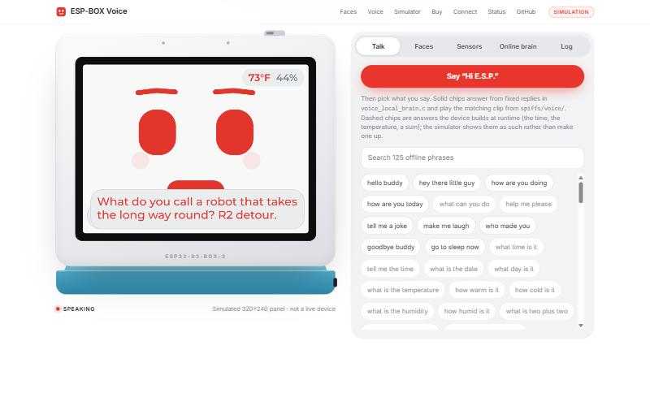
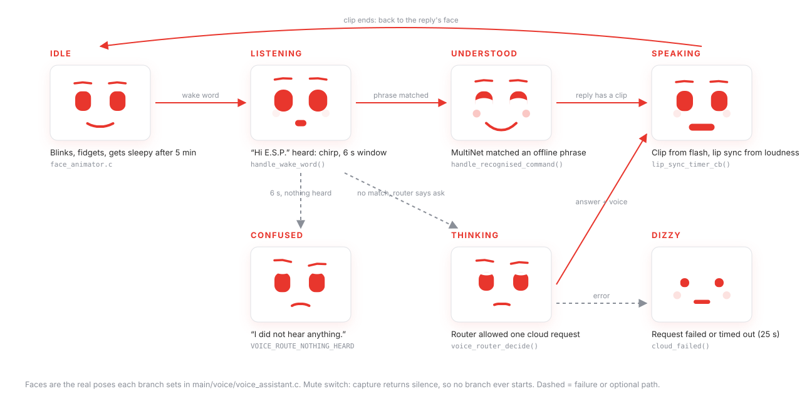
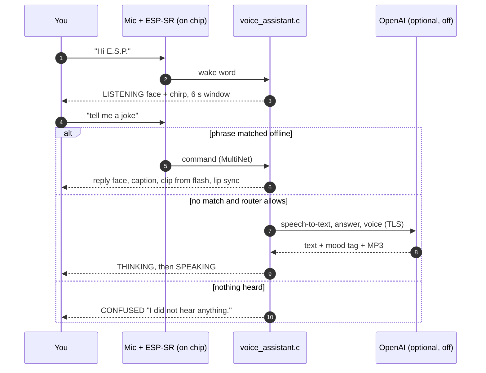
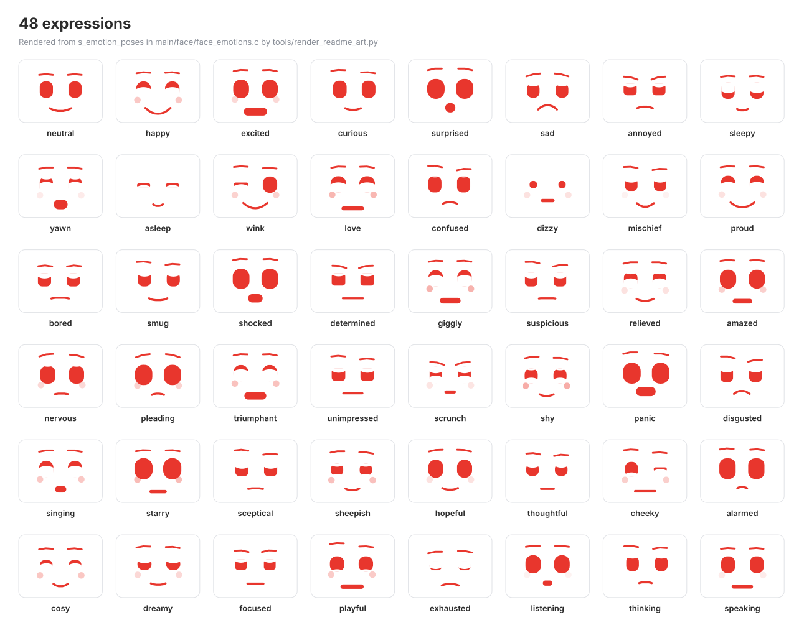
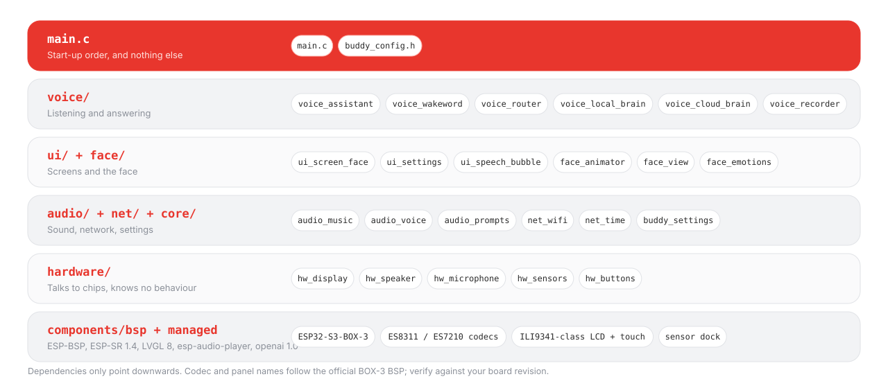

<p align="center">
  
</p>

<p align="center">
  <a href="https://normansrule.github.io/esp-box-voice-assistant/"><b>Live simulator</b></a> &nbsp;·&nbsp;
  <a href="#build-and-flash">Build</a> &nbsp;·&nbsp;
  <a href="#voice-states">Voice states</a> &nbsp;·&nbsp;
  <a href="#48-expressions">Expressions</a> &nbsp;·&nbsp;
  <a href="#status">Status</a> &nbsp;·&nbsp;
  <a href="docs/FIRMWARE_GUIDE.md">Full firmware guide</a>
</p>

<p align="center">
  
  
  
  
</p>

**ESP-BOX Voice** is the Desk Buddy firmware for the **ESP32-S3-BOX-3**: a face on a 320×240 touchscreen that hears **“Hi E.S.P.”** on the chip, answers **125 English phrases offline**, speaks from **356 recorded clips** in flash, and only asks an online model when you switch that on.

> [!NOTE]
> The web page and every image in this README are drawn from the firmware's own tables by `tools/`. They are **simulations of the UI**, not captures from a device. Nothing here shows a device reading.

## Try it in the browser

<p align="center">
  <a href="https://normansrule.github.io/esp-box-voice-assistant/"></a>
</p>

The [simulator](https://normansrule.github.io/esp-box-voice-assistant/) runs the same pose table, blink and antic timings, reply table and voice clips as the firmware:

| On the page | Where it comes from |
| --- | --- |
| Face, 48 expressions, 12 idle antics, blink timing | `main/face/face_emotions.c`, `face_view.c`, `face_animator.c`, ported line for line to canvas in `web/assets/face.js` |
| Spoken replies and the face each one pulls | `main/voice/voice_local_brain.c`, extracted by `tools/extract_firmware_data.py` |
| Voice audio | the actual `spiffs/voice/*.mp3` clips, looked up by the same FNV-1a hash the firmware uses |
| Lip sync | WebAudio level computed like `hw_speaker.c` (mean absolute sample / 5500, snap up, ease down) |
| Settings screen | the sections and defaults of `ui_settings.c` and `buddy_settings_reset_to_defaults()` |
| “Online brain” tab | a port of the pure function `voice_router_decide()`; nothing is sent anywhere |
| Temperature, humidity, presence | **sliders you move**, clearly tagged as simulated input |

Runtime answers the device builds on the fly (time, temperature, timers, sums) are marked as such in the simulator instead of being invented.

## Voice states

<p align="center"></p>



The mute switch on top stops capture in `hw_microphone.c`, so the wake word never reaches WakeNet. Firmware v3.7.1 shows no on-screen mute indicator; the simulator does not invent one.

## 48 expressions

<p align="center"></p>

Each face is one row of 21 numbers in `s_emotion_poses`. Moving between two faces is a linear blend, so one tween animates all of them. Change the palette in `main/face/face_theme.h`:

| Token | Hex | Used for |
| --- | --- | --- |
| `FACE_HEX_ESPRESSIF_RED` |  `#E8362D` | eyes, brows, mouth, buddy's captions |
| `FACE_HEX_ESPRESSIF_RED_DARK` |  `#B8241C` | pressed states |
| `FACE_HEX_BLUSH` |  `#F7ADA8` | cheeks |
| `FACE_HEX_BACKGROUND` | `#FFFFFF` | the screen |
| `FACE_HEX_TEXT` / `TEXT_MUTED` | `#2B2B2B` / `#8A8F98` | your words / status lines |
| `FACE_HEX_SURFACE` / `SURFACE_BORDER` | `#F2F3F5` / `#E0E2E6` | chips, bubble, gear |

## Architecture

<p align="center"></p>

If you read one file, read `main/voice/voice_assistant.c`. If you want to change how it looks, read `main/face/face_pose.h`.

## Get the hardware

One off-the-shelf Espressif kit, no soldering. Links are Espressif's [official sellers](https://www.espressif.com/en/dev-board/esp32-s3-box-3-en); prices and stock change.

| Kit | What you get | Buy |
| --- | --- | --- |
| **ESP32-S3-BOX-3** (recommended) | Main unit + BOX-3-SENSOR dock (temperature/humidity, radar, IR, microSD, 18650 slot) + DOCK, BRACKET, BREAD | [Espressif](https://www.espressif.com/en/dev-board/esp32-s3-box-3-en) · [Adafruit](https://www.adafruit.com/product/5835) · [Amazon](https://www.amazon.com/dp/B0CL6HD8JX) · [DigiKey](https://www.digikey.com/en/products/detail/espressif-systems/ESP32-S3-BOX-3/21556209) · [Mouser](https://www.mouser.com/ProductDetail/Espressif-Systems/ESP32-S3-BOX-3) · [AliExpress](https://www.aliexpress.com/item/1005006169541505.html) |
| **ESP32-S3-BOX-3B** | Main unit + DOCK only. Everything works except the temperature readout and presence radar | [Adafruit](https://www.adafruit.com/product/5883) · [Amazon](https://www.amazon.com/gp/product/B0CSJC5BX6) · [DigiKey](https://www.digikey.com/en/products/detail/espressif-systems/ESP32-S3-BOX-3B/22286690) · [Mouser](https://www.mouser.com/ProductDetail/Espressif-Systems/ESP32-S3-BOX-3B) |

No affiliate tags are set, so these links earn nothing. Tags live in one place, `web/assets/shop.js`, and the site shows a disclosure automatically once one is filled in. The firmware does not measure the 18650 battery yet; use a protected cell and Espressif's charging instructions.

## Build and flash

Requires **ESP-IDF v5.5.x**. Not v6: it removed the legacy I2C driver the sensor-dock support uses. Keep the clone path free of spaces (ESP-SR passes library paths to the linker unquoted).

Windows, from the **ESP-IDF 5.5 CMD** shortcut:

```bat
git clone https://github.com/Normansrule/esp-box-voice-assistant
cd esp-box-voice-assistant
idf.py set-target esp32s3
idf.py build
```

Find the port, then flash:

```bat
mode
```

```bat
set ESP_PORT=COM9
idf.py -p %ESP_PORT% flash monitor
```

Linux:

```bash
. "$IDF_PATH/export.sh"
idf.py set-target esp32s3 && idf.py build
ls /dev/serial/by-id/
idf.py -p "$ESP_PORT" flash monitor
```

`Ctrl` + `]` leaves the monitor. If the port never appears, hold **BOOT** while plugging in USB-C. To go back to Espressif's factory demo, flash the stock `factory_test_fw-ESP-BOX-3.bin` from the [esp-box repository](https://github.com/espressif/esp-box) with the [ESP Launchpad](https://espressif.github.io/esp-launchpad/) or `esptool.py`.

**Verified on this repository's commit:** `idf.py build` with ESP-IDF v5.5.5 (GCC 14.2.0) produces a 1,965,360-byte app, 47% of the smallest app partition free. Details in [docs/BUILD_RESULTS.md](docs/BUILD_RESULTS.md). Flashing and on-device behaviour were not re-tested for this repository.

### The online brain, safely

It ships **off**. To use it, put a project-scoped key with a low monthly limit in `spiffs/openai_key.txt` (copy `spiffs/openai_key.example.txt`). That file is in `.gitignore` and must never be committed. The key is stored unencrypted on the device, so anyone with USB access can read it back. See [SECURITY.md](SECURITY.md).

## Tools

| Command | What it does |
| --- | --- |
| `python tools/extract_firmware_data.py` | Re-extracts faces, phrases and replies into `web/assets/firmware-data.js` (`--check` fails if stale) |
| `python tools/render_readme_art.py` | Redraws the SVGs in `docs/assets/` from that data |
| `python tools/build_site.py` | Builds the site into `_site/` with the real voice clips and chimes |
| `python -m http.server 8000 --directory _site` | Preview the site locally |
| `python scripts/run_tests.py` | Host unit tests (needs a desktop C compiler; CI runs them on Ubuntu) |
| `python scripts/check_sources.py` | Static sanity check of the firmware sources |

## Status

| Feature | State | Evidence |
| --- | --- | --- |
| Firmware build, esp32s3, ESP-IDF v5.5.5 | **Verified build** | [docs/BUILD_RESULTS.md](docs/BUILD_RESULTS.md) |
| Face, expressions, antics, lip sync | In firmware | `main/face/` |
| Wake word and offline phrases (ESP-SR) | In firmware | `main/voice/` |
| Offline voice clips | In firmware | `spiffs/voice/` |
| Online brain (OpenAI), off by default | In firmware | `voice_cloud_brain.c`, `voice_router.c` |
| Temperature, humidity, presence (sensor dock) | In firmware | `hw_sensors.c` |
| Host unit tests | Runs in CI | `.github/workflows/ci.yml` |
| Battery monitoring | **Planned** | needs a verified battery accessory and voltage sense first |
| IMU gestures (onboard ICM42670 per the BSP) | **Planned** | not read by this firmware yet |
| Web simulator | **Simulation** | browser only, never device data |

Roadmap and hardware rules: [docs/ROADMAP.md](docs/ROADMAP.md).

## Repository layout

```
main/            firmware (face/, voice/, ui/, audio/, hardware/, net/, core/)
components/bsp/  board support from espressif/esp-box (Apache-2.0)
spiffs/          chimes, music, offline voice clips (flashed to "storage")
tests/ scripts/  host tests and source checks
tools/           data extraction, README art, site build
web/             the simulator site (GitHub Pages)
docs/            guide, build results, roadmap, images
```

## License

Firmware, tools, site and audio: Unlicense OR CC0-1.0 (see [LICENSE](LICENSE)). `components/bsp/` comes from [espressif/esp-box](https://github.com/espressif/esp-box) under Apache-2.0 ([components/bsp/LICENSE](components/bsp/LICENSE)). Managed components keep their own licenses. Music is synthesised by `scripts/make_music.py` from public-domain scores; voice clips are rendered by `scripts/make_voice_clips.py` with eSpeak NG.
